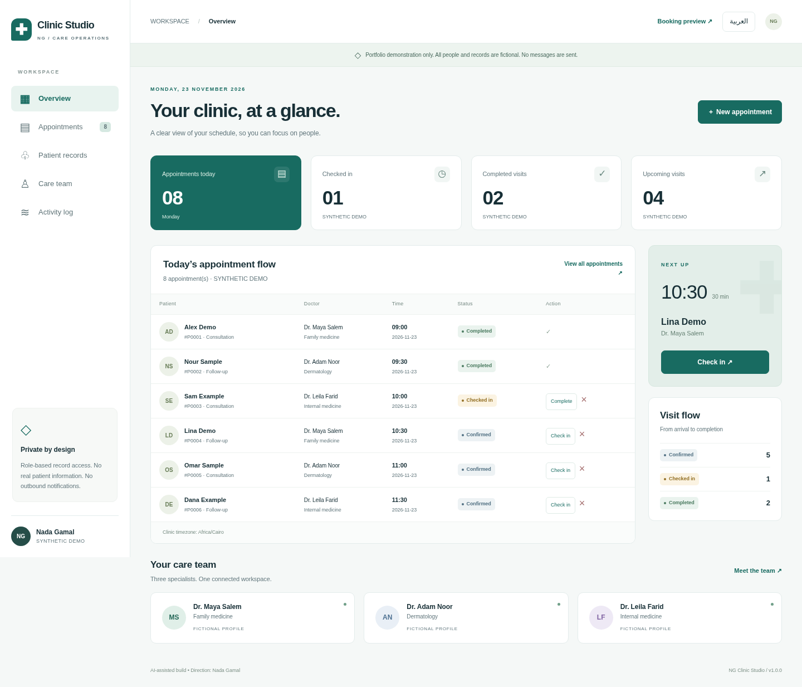
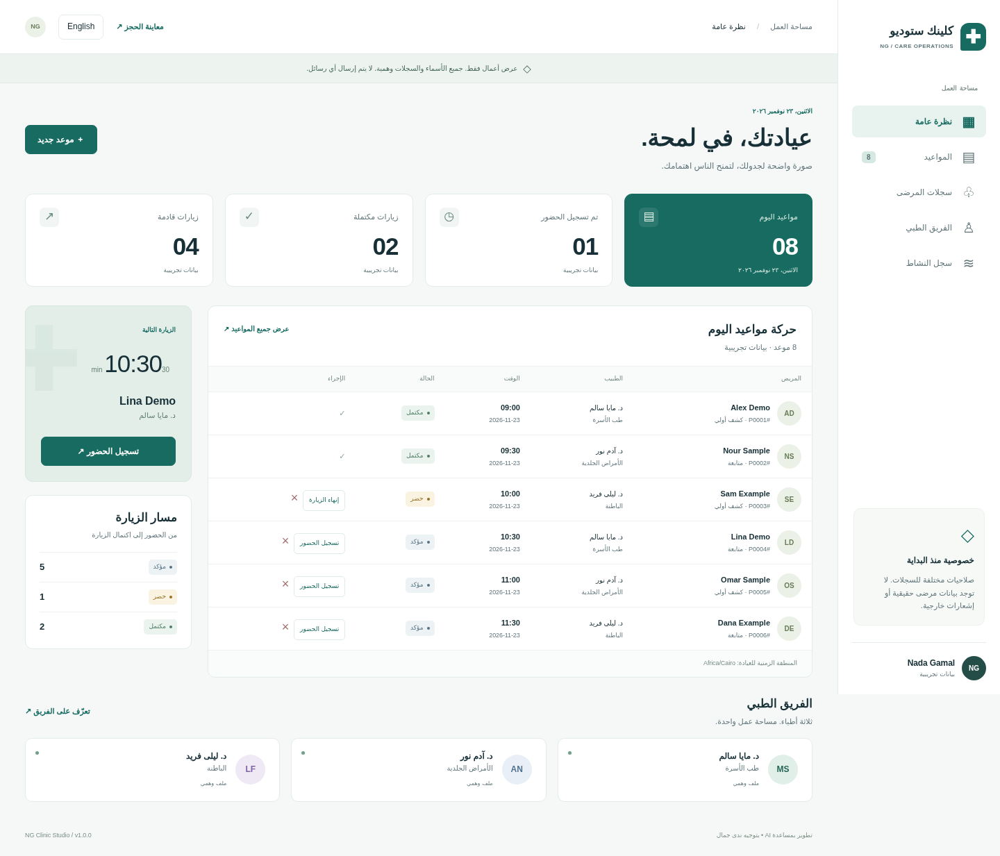
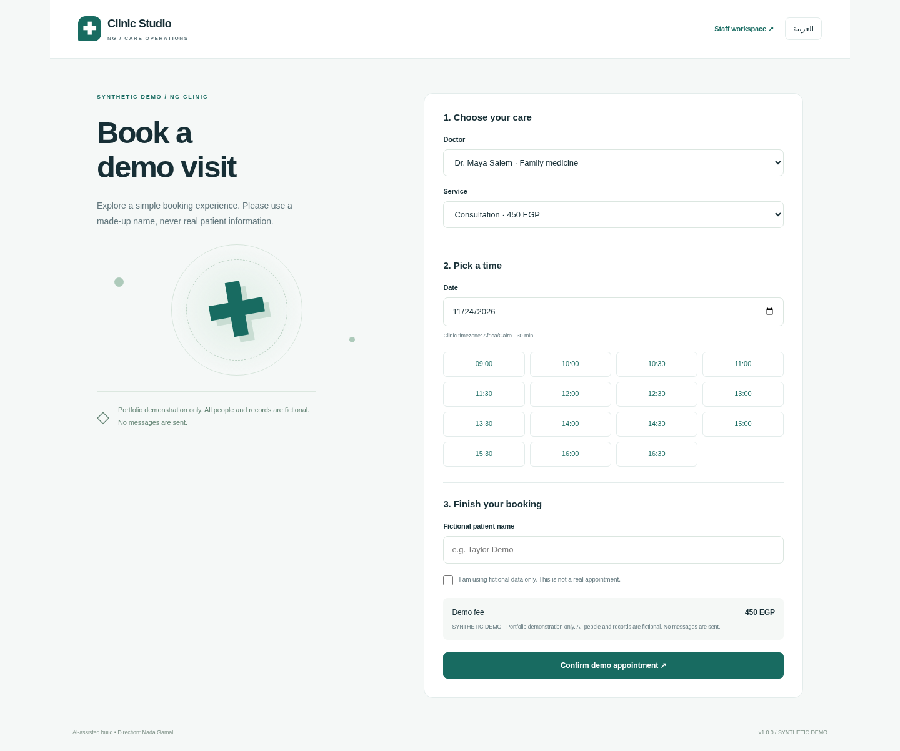
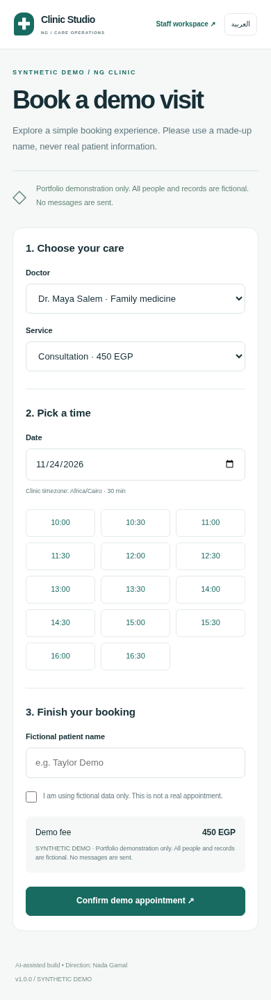
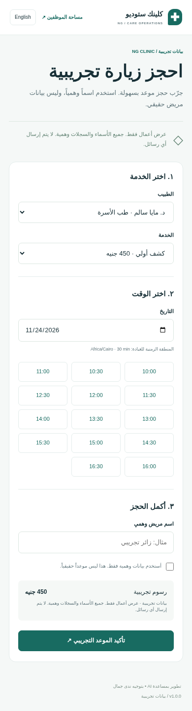
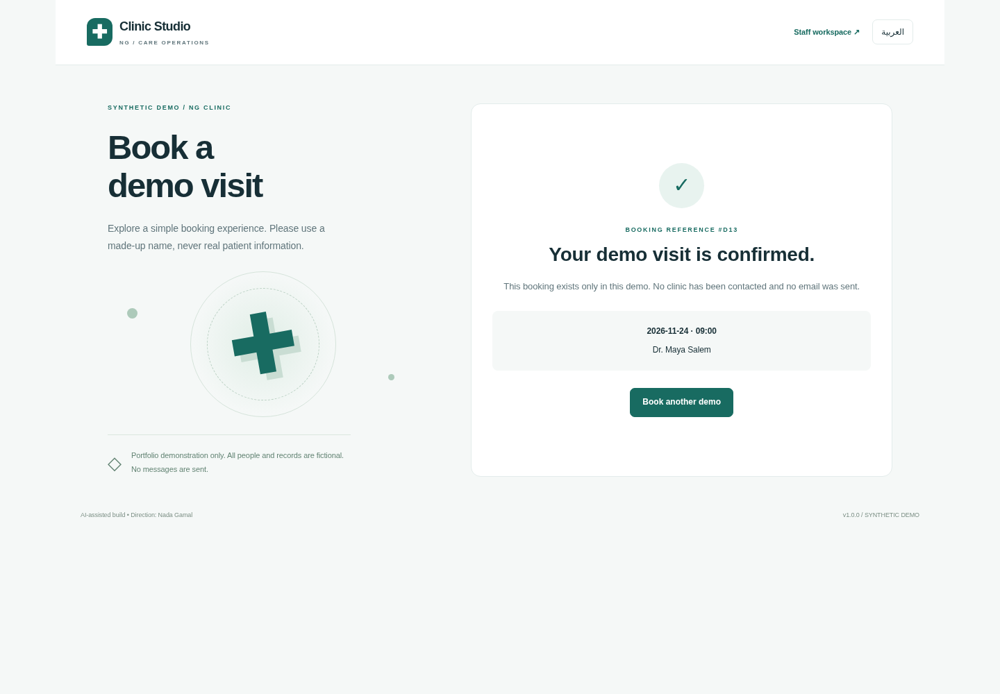
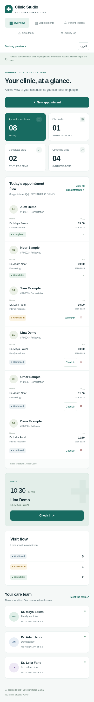
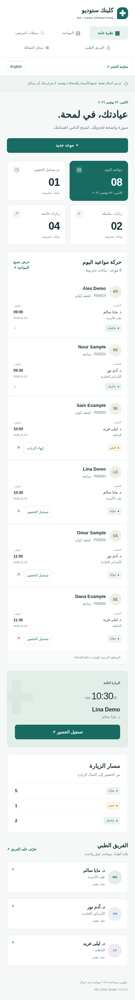

# NG Clinic Studio 1.0.0

A custom WordPress clinic-workflow demonstration, built with synthetic data only.
AI-assisted implementation, under Nada Gamal's direction. This is portfolio work,
not evidence of a deployed clinic system, and not a claim that Nada wrote all code.

## Screenshots

| Staff overview (EN) | Staff overview (AR / RTL) |
|---|---|
|  |  |

| Booking (desktop) | Booking (mobile, EN) |
|---|---|
|  |  |

| Booking (mobile, AR) | Booking confirmation |
|---|---|
|  |  |

| Overview (mobile, EN) | Overview (mobile, AR) |
|---|---|
|  |  |

The installable plugin lives in `ng-clinic/`; the optional disposable test harness is described in `TEST-HARNESS.md`.

## Safety boundary

**Do not put real names, appointments, patient information, contact details, or
medical records into this demonstration. Do not install it on the real clinic
website.** Use a local or isolated staging WordPress site. It is not a medical
product, not a clinical record system, and has not had a production security,
privacy, regulatory, accessibility, or healthcare compliance audit.

No email, WhatsApp, payment, analytics or external API integrations exist. All
notifications are simulation-log entries. Displayed EGP fees are fictional demo
prices; nothing is charged. Notes are stored as ordinary WordPress database text,
not encrypted clinical data. Demo records are shared across users with the
relevant capabilities. Clinicians can see all demo notes, not only their own.

## Install in LocalWP or staging

1. Back up the test site. Use WordPress 6.4+ and PHP 7.4+ (tested: PHP 8.3).
2. In WordPress, open Plugins > Add New > Upload Plugin.
3. Upload `ng-clinic-studio-1.0.0.zip`, install and activate.
4. Set Settings > General > Timezone to the clinic timezone, e.g. Africa/Cairo.
5. Open **Clinic Studio** in the admin menu, then **Open Clinic Studio** for the
   full-screen workspace. Activation creates 12 fictional profiles and 12 visits
   dated relative to activation, plus three fictional doctors and two services.
6. Use **Booking preview** for the public demonstration form. The full-screen
   booking page is the site's home URL with `?ng_booking=1`. Staff access is
   the site's home URL with `?ng_clinic=1` and requires WordPress login.
7. Optionally place `[ng_clinic_booking]` in a WordPress Shortcode block or
   Elementor Shortcode widget. The same working form renders in the page.
   Do not place the shortcode more than once on the same page.
8. Switch English / العربية in the header. The choice stays in this browser.

The full-screen UI includes its own styles and no external fonts, images or JS.
Shortcode views inherit the surrounding theme; some themes may need style work.
Exclude booking pages and plugin REST routes from page caching/CDNs. Nonces can
expire: reload the page if a save or booking asks you to do so.

## A two-minute walkthrough

- On Overview, inspect the counters and today's visit flow.
- Open Appointments; search for a fictional name and filter by date/status.
- A confirmed visit can be checked in, then completed. A confirmed or checked-in
  visit can be cancelled. Completed and cancelled states are terminal. Cancellation
  frees the slot. Incorrect transitions return a conflict rather than overwriting.
- Open Patient records, choose a record, and save a synthetic note as admin or
  clinician. Receptionists cannot fetch or save notes, including through the API.
- In Booking preview select doctor, service, future date and time, enter a made-up
  name and tick the fictional-data confirmation. Submit and inspect the reference.
- Return to Appointments, choose that date, and find the saved visit. Refreshing
  preserves it in the database. Activity log records the simulated notification.

Bookings are 30 minutes, 09:00 to 17:00, every day, for the next 60 calendar days.
Past slots disappear. The default booking day moves to tomorrow after hours.
The doctor/service roster and availability hours are intentionally fixed demo
configuration in `includes/class-store.php`, not a production scheduling engine.
There are no holidays, recurring appointments, rescheduling, prescriptions,
billing, multi-clinic separation, actual reminders or patient accounts.

## Roles

| WordPress role | Schedule and basic fictional profiles | Demo notes |
|---|---|---|
| Administrator | Read and manage | Read/write |
| Clinic clinician (demo) | Read and manage | Read/write |
| Clinic receptionist (demo) | Read and manage | No access |
| Subscriber / anonymous | No staff access | No access |

Public visitors can read service/doctor/availability information and submit a
synthetic booking only. Responses contain no patient details. Create test users
through WordPress Users if you want to try the extra roles. **No demo users or
passwords are created by the plugin itself.** Do not give those roles to real staff.

## Implementation

- PHP classes separated into plugin integration, storage and REST controllers.
- Custom database tables: `{prefix}ngc_patients`, `ngc_appointments`, `ngc_log`.
- Unique nullable slot key prevents duplicate active bookings for a doctor/time.
  A cancelled appointment releases its key; terminal records remain in history.
- Conditional status writes reject stale competing workflow updates.
- WordPress REST cookie authentication, REST nonces, per-route capabilities,
  booking-specific nonce, fixed route methods, input validation/sanitization,
  prepared SQL lookups, database API writes and escaped DOM rendering.
- Public booking rate limit: 12 successful bookings per IP per 10-minute transient
  window. This is basic demo protection, not production anti-abuse infrastructure.
- Compensation deletes an incomplete record on a failed related insert/update.
  This is not a database-wide transactional clinical workflow.
- Native JavaScript fetch interface; no build step or runtime JS dependencies.
- English/Arabic dictionary and logical CSS for RTL. WordPress admin integration
  strings use the `ng-clinic` text domain. Polylang is not required or verified.

## Removal and data

Deactivation retains demo records. **Deleting the plugin through WordPress runs
uninstall.php and deletes the three plugin tables, seed option, custom roles and
administrator plugin capabilities.** It does not delete WordPress users or pages.
Back up anything you want to keep first. Removing files by hand does not run the
uninstaller. Standard site backups may retain older copies of demo data.

## Verification and reproducibility

See `TEST-REPORT.md` and `tests/` in the separate source bundle. Functional tests
run against a real WordPress installation in WordPress Playground, with PHP 8.3
and WordPress's SQLite integration. MySQL/MariaDB has not been exercised in this
release, despite use of normal WordPress dbDelta and database APIs. Test on the
specific LocalWP stack before using it in a presentation. Elementor itself was
not installed; the underlying WordPress shortcode is verified.

Installable plugin has no npm dependencies. The optional verification harness
uses WordPress Playground and Playwright, which are development tools only.

License: GPL-2.0-or-later. All UI artwork is CSS; no third-party media assets.
